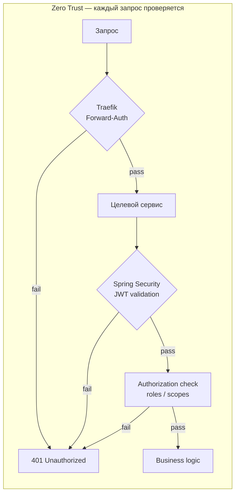
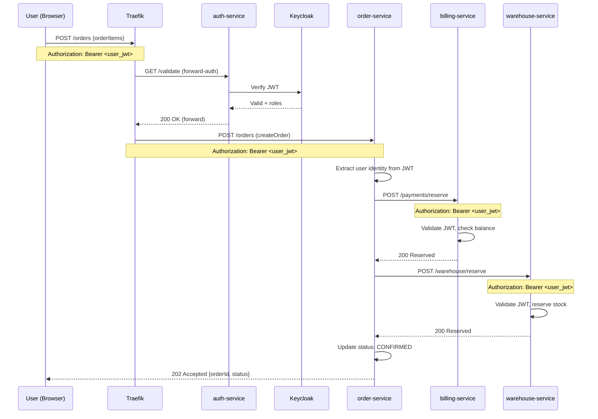
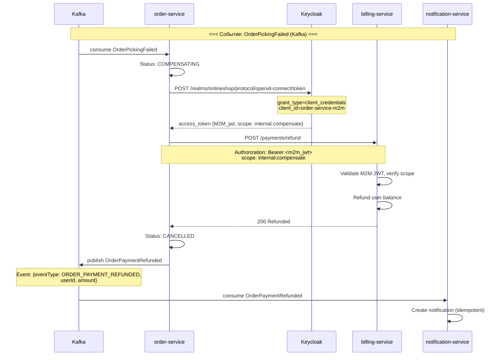
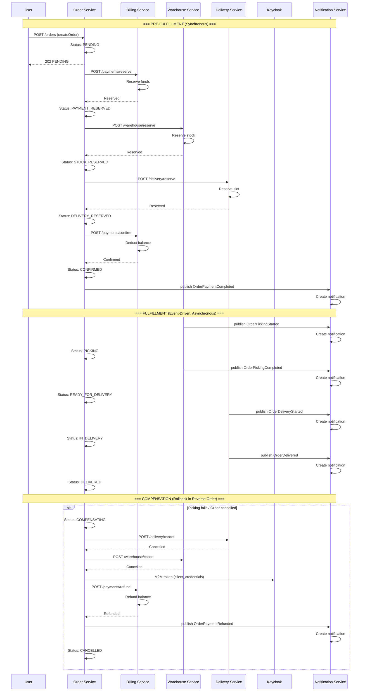
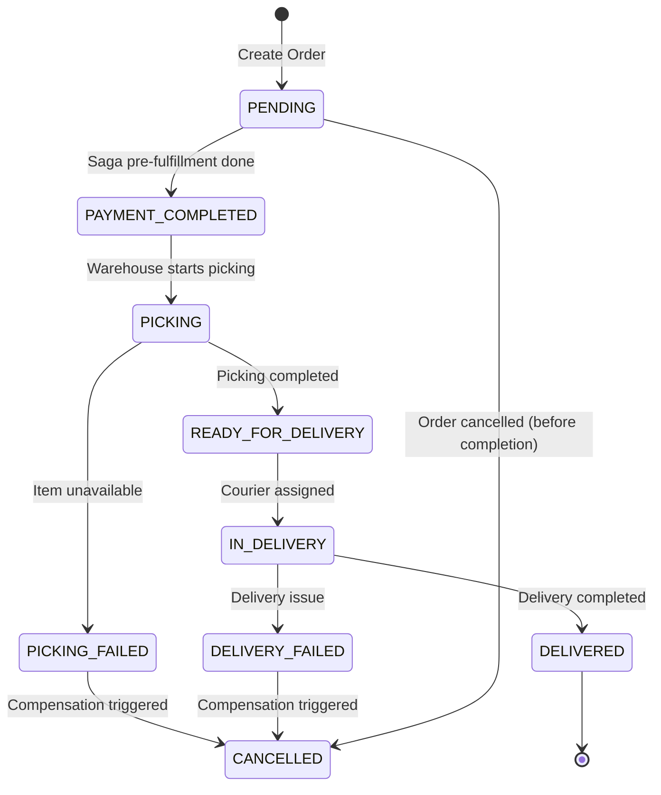

# Онлайн-магазин на основе микросервисной архитектуры

## Содержание

- [1. Общая информация](#1-общая-информация)
- [2. Паттерны микросервисной архитектуры](#2-паттерны-микросервисной-архитектуры)
    - [Паттерны распределённых данных](#паттерны-распределённых-данных)
    - [Паттерны коммуникации](#паттерны-коммуникации)
    - [Паттерны надёжности](#паттерны-надёжности)
    - [Паттерны наблюдаемости](#паттерны-наблюдаемости)
    - [Паттерны маршрутизации](#паттерны-маршрутизации)
    - [Инфраструктурные паттерны](#инфраструктурные-паттерны)
- [3. Состав микросервисов](#3-состав-микросервисов)
- [4. Технологический стек](#4-технологический-стек)
    - [Схемы баз данных](#схемы-баз-данных)
- [5. Аутентификация и авторизация](#5-аутентификация-и-авторизация)
    - [Архитектурный компромисс и подход Zero Trust](#архитектурный-компромисс-и-подход-zero-trust)
    - [Диаграммы сценариев аутентификации](#диаграммы-сценариев-аутентификации)
- [6. Основной пользовательский сценарий](#6-основной-пользовательский-сценарий)
    - [6.1. Пользовательский поток](#61-пользовательский-поток)
    - [6.2. Диаграмма саги](#62-диаграмма-саги)
    - [6.3. Диаграмма статусов заказа](#63-диаграмма-статусов-заказа)
- [7. Тестирование](#7-тестирование)
    - [Postman Collection](#postman-collection)
    - [Структура тестов](#структура-тестов)
        - [Секция 1: Подготовка администратора (7 запросов)](#секция-1-подготовка-администратора-7-запросов)
        - [Секция 2: Регистрация пользователя (2 запроса)](#секция-2-регистрация-пользователя-2-запроса)
        - [Секция 3: Операции пользователя (2 запроса)](#секция-3-операции-пользователя-2-запроса)
        - [Секция 4: Успешная сага (12 запросов)](#секция-4-успешная-сага-12-запросов)
        - [Секция 5: Компенсация саги (9 запросов)](#секция-5-компенсация-саги-9-запросов)
    - [Переменные окружения](#переменные-окружения)
    - [Запуск тестов](#запуск-тестов)
- [8. Развёртывание](#8-развёртывание)
    - [Структура Kubernetes](#структура-kubernetes)
    - [Namespace-ы](#namespace-ы)
    - [Инструкция по развёртыванию](#инструкция-по-развёртыванию)

---

## 1. Общая информация

**Online Shop** — это распределённая система электронной коммерции, спроектированная по принципам микросервисной
архитектуры.
Система позволяет пользователям регистрироваться, управлять платёжным балансом, оформлять заказы и отслеживать их
выполнение на всех этапах — от оплаты до доставки.

Система построена вокруг **Domain-Driven Design (DDD)** подхода: каждый микросервис инкапсулирует отдельное
бизнес-доменное
понятие (аутентификация, платежи, склад, доставка, уведомления, управление заказами) и обладает собственным хранилищем
данных.
Взаимодействие между сервисами осуществляется асинхронно через Apache Kafka и синхронно через REST API.

Распределённые транзакции обеспечиваются паттерном **Saga** (оркестратор), который координирует последовательность
локальных транзакций и выполняет компенсацию в случае ошибки.

Развёртывание осуществляется в Kubernetes с использованием Helm-чартов, с инкапсуляцией инфраструктуры (Kafka,
PostgreSQL),
identity-провайдера (Keycloak), логирования (EFK) и мониторинга (Prometheus + Grafana).

**Ключевые потоки данных:**

| Поток                   | Направление                                       | Протокол                  | Описание                                 |
|-------------------------|---------------------------------------------------|---------------------------|------------------------------------------|
| Пользовательский запрос | Browser → Traefik → Service                       | HTTP + JWT                | Через API Gateway с Forward-Auth         |
| Создание заказа         | order-service → billing/warehouse/delivery        | REST API                  | Синхронная оркестрация саги              |
| Подтверждение оплаты    | order-service → billing-service                   | REST API                  | Confirm payment hold                     |
| События комплектации    | warehouse-service → order-service                 | Kafka (orders)            | Асинхронный статус PICKING/READY         |
| События доставки        | delivery-service → order-service                  | Kafka (orders)            | Асинхронный статус IN_DELIVERY/DELIVERED |
| Уведомления             | billing/warehouse/delivery → notification-service | Kafka                     | Event-driven подписка                    |
| Аутентификация          | Client → Keycloak                                 | OIDC                      | Выдача и валидация JWT                   |
| M2M-авторизация         | order-service → billing-service                   | OAuth2 client_credentials | Компенсационные вызовы                   |

Диаграмма развёртывания:


---

## 2. Паттерны микросервисной архитектуры

### Паттерны распределённых данных

| Паттерн                         | Описание                                                                                                                                         | Где применяется                                      |
|---------------------------------|--------------------------------------------------------------------------------------------------------------------------------------------------|------------------------------------------------------|
| **Database per Service**        | Каждый сервис имеет собственную базу данных PostgreSQL, обеспечивая полную изоляцию данных                                                       | Все микросервисы                                     |
| **Outbox Pattern**              | События сохраняются в таблице `outbox_events` в рамках локальной транзакции, затем асинхронно публикуются в Kafka                                | Все микросервисы                                     |
| **Saga Orchestration**          | Центральный оркестратор (`OrderSagaOrchestrator`) координирует распределённую транзакцию, вызывая сервисы по HTTP и реагируя на события из Kafka | order-service                                        |
| **Idempotent Event Processing** | Таблица `processed_events` предотвращает дублирование обработки событий при повторных доставках                                                  | billing-service, notification-service, order-service |

### Паттерны коммуникации

| Паттерн                        | Описание                                                                                                    | Где применяется                            |
|--------------------------------|-------------------------------------------------------------------------------------------------------------|--------------------------------------------|
| **Event-Driven Communication** | Сервисы обмениваются событиями через Kafka для асинхронной координации                                      | Все сервисы                                |
| **Synchronous REST API**       | Оркестратор вызывает сервисы-участники саги по HTTP для резервирования и подтверждения операций             | order-service → billing/warehouse/delivery |
| **M2M Authentication**         | Service-to-service аутентификация через OAuth2 `client_credentials` (Keycloak) для компенсационных операций | order-service → billing-service            |

### Паттерны надёжности

| Паттерн                     | Описание                                                                          | Где применяется                |
|-----------------------------|-----------------------------------------------------------------------------------|--------------------------------|
| **Retry with Backoff**      | Автоматический повтор с экспоненциальной задержкой (3 повтора, 1–4с, джиттер 0.5) | WebClient в order-service      |
| **Dead Letter Queue (DLQ)** | Невостребованные события направляются в DLQ-топики (5 DLQ-топиков для 5 основных) | Kafka-консументы всех сервисов |
| **Idempotency Keys**        | Дедупликация запросов на создание заказа по уникальному ключу                     | order-service                  |
| **Pessimistic Locking**     | `SELECT ... FOR UPDATE` для защиты резервирования складских запасов               | warehouse-service              |

### Паттерны наблюдаемости

| Паттерн                | Описание                                                                             | Где применяется     |
|------------------------|--------------------------------------------------------------------------------------|---------------------|
| **Structured Logging** | JSON-логирование через Logstash Logback Encoder для парсинга Fluent Bit              | Все микросервисы    |
| **EFK Stack**          | Elasticsearch + Fluent Bit + Kibana для централизованного сбора и визуализации логов | Namespace `logging` |
| **Prometheus Metrics** | Micrometer + `/actuator/prometheus` для сбора метрик (HTTP-запросы, бизнес-метрики)  | Все микросервисы    |
| **ServiceMonitor**     | Prometheus Operator CRD для автоматического discovery сервисов                       | Namespace `app`     |
| **Health Probes**      | Spring Boot Actuator readiness/liveness probes для Kubernetes                        | Все микросервисы    |

### Паттерны маршрутизации

| Паттерн                   | Описание                                                                                                         | Где применяется       |
|---------------------------|------------------------------------------------------------------------------------------------------------------|-----------------------|
| **API Gateway (Traefik)** | Ingress-контроллер с маршрутизацией по path prefix, stripping prefix и Forward-Auth middleware для валидации JWT | Traefik → все сервисы |

### Инфраструктурные паттерны

| Паттерн                        | Описание                                                                     | Где применяется           |
|--------------------------------|------------------------------------------------------------------------------|---------------------------|
| **Forward-Auth**               | Все запросы (кроме auth-service) проходят валидацию JWT через auth-service   | Traefik `auth-middleware` |
| **Multi-namespace Deployment** | Разделение на 5 namespaces: `infra`, `keycloak`, `app`, `logging`, `ingress` | Kubernetes                |
| **Schema Migration**           | Liquibase для версионирования и применения схем БД                           | Все сервисы               |
| **Multi-stage Docker Build**   | Maven-билдер → JRE-рантайм для минимизации образа                            | Все Dockerfile            |

---

## 3. Состав микросервисов

Разбиение на сервисы выполнено согласно **Domain-Driven Design (DDD)** — каждый сервис покрывает отдельное поддоменное
пространство.

### auth-service

**Назначение:** Аутентификация, регистрация пользователей и интеграция с Keycloak.

**Функционал:**

- Регистрация новых пользователей (создание в Keycloak + локальная БД)
- Аутентификация (login) и валидация JWT-токенов
- Публикация события `UserRegistered` в Kafka (Outbox Pattern)
- M2M-аутентификация для межсервисного взаимодействия

### order-service

**Назначение:** Управление заказами и оркестрация распределённых саг.

**Функционал:**

- Создание, получение и отмена заказов
- Оркестрация саги (pre-fulfillment + fulfillment + compensation)
- Idempotency key для дедупликации запросов
- Реактивный WebClient для вызова сервисов-участников саги
- Управление состоянием саги (`order_saga_states`)

### billing-service

**Назначение:** Обработка платежей и управление платёжными балансами.

**Функционал:**

- Создание учётных записей пользователей при регистрации
- Пополнение баланса (deposit)
- Резервирование средств (hold), подтверждение (confirm), отмена (cancel), возврат (refund)
- Обработка событий `UserRegistered` и `OrderPaymentCompleted` из Kafka

### warehouse-service

**Назначение:** Управление складскими запасами и операциями комплектации.

**Функционал:**

- Каталог товаров (items) с SKU
- Управление складскими остатками (available / reserved quantity)
- Резервирование и освобождение запасов с pessimistic locking
- Операции комплектации (picking): старт, завершение, отмена с присвоением tracking number
- Публикация событий `OrderPickingStarted/Completed/Failed`

### delivery-service

**Назначение:** Управление доставкой, курьерами и временными слотами.

**Функционал:**

- Управление курьерами и их статусами
- Управление временными слотами доставки (capacity management)
- Резервирование и отмена доставки
- Назначение курьеров на заказы и обработка операций доставки
- Публикация событий `OrderDeliveryStarted/Delivered/Failed`

### notification-service

**Назначение:** Уведомления пользователей о событиях системы.

**Функционал:**

- Подписка на события из топиков `payments` и `orders`
- Создание записей уведомлений для всех ключевых событий (оплата, комплектация, доставка, возврат)
- Idempotent обработка событий (защита от дублирования)
- REST API для получения уведомлений пользователя

### contracts

**Назначение:** Общие Protocol Buffers определения для кросс-сервисных событий.

**Функционал:**

- Единая схема `EventEnvelope` с типами событий (`UserRegistered`, `OrderCreated`, `OrderPaymentCompleted`,
  `OrderPickingStarted`, `OrderDelivered` и др.)
- Генерация Java-классов из `.proto` через OpenAPI Generator

---

## 4. Технологический стек

| Компонент              | Технология                               | Версия / Детали                                    |
|------------------------|------------------------------------------|----------------------------------------------------|
| **Язык**               | Java                                     | 21 (Eclipse Temurin)                               |
| **Фреймворк**          | Spring Boot                              | 4.1.1                                              |
| **ORM**                | Spring Data JPA + Hibernate              | Встроен в spring-boot-starter-data-jpa             |
| **Миграции БД**        | Liquibase                                | Встроен в spring-boot-starter-liquibase            |
| **Базы данных**        | PostgreSQL                               | Каждая сервисная БД в namespace `infra`            |
| **Message Broker**     | Apache Kafka (Confluent CP)              | 7.5.0, 1 broker, 5 топиков + 5 DLQ                 |
| **Identity Provider**  | Keycloak                                 | 26.0.7, realm `onlineshop`                         |
| **API Gateway**        | Traefik                                  | Ingress Controller, Forward-Auth middleware        |
| **Логирование**        | Logstash Logback Encoder + Fluent Bit    | JSON-формат → Elasticsearch                        |
| **Визуализация логов** | Kibana                                   | 8.11.0                                             |
| **Мониторинг**         | Prometheus + Grafana                     | ServiceMonitor CRD, 30s scrape interval            |
| **Сериализация**       | Protocol Buffers                         | 3.25.1, shared через модуль `contracts`            |
| **API Docs**           | SpringDoc OpenAPI                        | 3.0.3                                              |
| **Генерация кода**     | OpenAPI Generator Maven Plugin           | 7.23.0                                             |
| **Реактивный стек**    | Spring WebFlux + Reactor Netty           | order-service (saga orchestration)                 |
| **Безопасность**       | Spring Security + OAuth2 Resource Server | JWT decoding, `@EnableMethodSecurity`              |
| **Контейнеризация**    | Docker                                   | Multi-stage builds (Maven builder → JRE runtime)   |
| **Оркестрация**        | Kubernetes                               | 5 namespaces, Helm-чарты для PostgreSQL и Keycloak |

### Схемы баз данных

| Сервис               | База данных       | Основные таблицы                                                                       |
|----------------------|-------------------|----------------------------------------------------------------------------------------|
| auth-service         | `auth_db`         | `app_users`, `outbox_events`                                                           |
| billing-service      | `billing_db`      | `accounts`, `payment_holds`, `outbox_events`, `processed_events`                       |
| order-service        | `order_db`        | `orders`, `order_saga_states`, `outbox_events`, `processed_events`, `idempotency_keys` |
| warehouse-service    | `warehouse_db`    | `items`, `stocks`, `reservations`, `picking_operations`                                |
| delivery-service     | `delivery_db`     | `couriers`, `delivery_slots`, `slot_reservations`, `delivery_operations`               |
| notification-service | `notification_db` | `notifications`, `processed_events`                                                    |

---

## 5. Аутентификация и авторизация

### Архитектура безопасности

```
┌──────────┐     JWT Token      ┌────────────┐
│  Client  │ ──────────────────►│  Traefik   │
│ (Browser)│ ◄──────────────────│  Gateway   │
└──────────┘   Authorized       └─────┬──────┘
                                      │ Forward-Auth
                                      ▼
                              ┌────────────────┐
                              │  auth-service  │
                              │  /validate     │
                              └────────────────┘
                                      │
                                      ▼
                              ┌────────────────┐
                              │    Keycloak    │
                              │  (OIDC/JWT)    │
                              └────────────────┘
```

### Механизмы аутентификации

**1. Пользовательская аутентификация (User ↔ Keycloak)**

- Пользователь регистрируется через `auth-service` → создаётся в Keycloak
- Вход выполняется по email/паролю через `/auth/login`
- Keycloak выдаёт JWT-токен (access token)
- Токен передаётся в заголовке `Authorization: Bearer <token>`

**2. Валидация токенов (Traefik Forward-Auth)**

- Все запросы к сервисам (кроме `auth-service`) проходят через middleware `auth-middleware`
- Traefik перенаправляет запрос на `/validate` в `auth-service`
- `auth-service` проверяет валидность JWT, извлекает роли и возвращает решение о доступе

**3. JWT-ролевая модель**

- `JwtAuthConverter` извлекает **realm roles** (`realm_access.roles`) и **client roles** (
  `resource_access.<client>.roles`)
- Роли префиксируются `ROLE_` для Spring Security
- Каждый сервис требует `isAuthenticated()` для всех endpoints

**4. Межсервисная аутентификация (M2M)**

- `order-service` использует OAuth2 `client_credentials` grant для получения токенов от Keycloak
- Scope: `internal:compensate` — для компенсационных операций саги
- Отдельные WebClient-бины (`m2m*WebClient`) передают JWT при вызовах billing/warehouse/delivery

### Клиенты Keycloak

| Клиент                  | Назначение                                          |
|-------------------------|-----------------------------------------------------|
| `keycloak-admin-client` | Административные операции в Keycloak (auth-service) |
| `keycloak-app-client`   | Пользовательская аутентификация (Login, Register)   |
| `order-service-m2m`     | Межсервисная аутентификация для сага-оркестрации    |

### Архитектурный компромисс и подход Zero Trust

**Идеальная модель (OIDC Authorization Code Flow with PKCE).**

В production-системах регистрация и аутентификация пользователя реализуются напрямую на стороне фронтенда через
**OpenID Connect (OIDC) Authorization Code Flow с PKCE** (Proof Key for Code Exchange). В этой модели:

- Фронтенд (SPA / mobile-приложение) взаимодействует с Keycloak напрямую — без участия бэкенд-сервисов
- Пользователь вводит учётные данные в интерфейсе Keycloak (hosted login page), и пароль **никогда не передаётся на
  бэкенд**
- PKCE защищает flow от interception-атак через генерацию `code_verifier` / `code_challenge` на стороне фронтенда
- Фронтенд получает `authorization code` → обменивает его на `access_token` + `id_token` напрямую от Keycloak
- Бэкенд получает только JWT-токен в заголовке `Authorization: Bearer` — без какого-либо доступа к учётным данным
  пользователя

**Текущая реализация — компромиссное решение.**

В данном проекте регистрация (`POST /auth/register`) и аутентификация (`POST /auth/login`) реализованы через
`auth-service`
на бэкенде. Это означает, что пользовательский пароль передаётся по сети на бэкенд-сервис, который затем
создаёт/валидирует
учётную запись в Keycloak.

Этот подход имеет следующие недостатки:

| Аспект          | Идеальная модель (PKCE)     | Текущая реализация                    |
|-----------------|-----------------------------|---------------------------------------|
| Передача пароля | Никогда не покидает браузер | Передаётся на бэкенд (`auth-service`) |
| Зона уязвимости | Только Keycloak             | `auth-service` + Keycloak             |
| Surface attack  | Минимальная (OIDC standard) | Расширенная (custom login endpoint)   |
| Compliance      | PCI DSS / OWASP aligned     | Требует дополнительных мер защиты     |

**Обоснование компромисса.**

Такой подход выбран для упрощения разработки и обучения: `auth-service` инкапсулирует логику создания пользователей в
Keycloak, управления клиентами и ролями, что позволяет фронтенду не реализовывать OIDC flow самостоятельно.
В production рекомендуется мигрировать на Authorization Code Flow with PKCE.

**Zero Trust Architecture.**

Несмотря на архитектурный компромисс, система реализует принципы **Zero Trust** (нулевого доверия):

- **Никому не доверяй, всегда проверяй** — каждый запрос, независимо от источника, проходит валидацию токена
- **Forward-Auth middleware** — Traefik перенаправляет каждый запрос на `/validate` в `auth-service` до того, как он
  достигнет целевого сервиса
- **Минимальные привилегии** — JWT содержит только необходимые realm/client roles; M2M-токены ограничены scope
  `internal:compensate`
- **Изоляция сервисов** — каждый сервис валидирует токен независимо через Spring Security; отказ одного компонента не
  отменяет проверку в других
- **Микросегментация** — M2M-авторизация использует отдельные client-конфигурации Keycloak, изолируя service-to-service
  трафик от пользовательского



### Диаграммы сценариев аутентификации

#### 1. Пользовательская операция — синхронные вызовы с JWT

Пользователь выполняет запрос (например, создание заказа). Запрос проходит через Traefik → Forward-Auth валидация JWT →
целевой сервис. Целевой сервис обрабатывает запрос от имени пользователя.



**Ключевые моменты:**

- Пользовательский JWT передаётся на каждом шаге синхронного вызова
- Каждый сервис валидирует токен через Spring Security (`@EnableMethodSecurity`)
- Forward-Auth middleware Traefik предварительно проверяет токен перед маршрутизацией
- Все сервисы вызывают `JwtAuthConverter` для извлечения realm/client ролей

---

#### 2. Асинхронная обработка — M2M токен для компенсационных вызовов

Сервис обрабатывает событие из Kafka и выполняет компенсационные вызовы других сервисов, используя M2M-токен (OAuth2
`client_credentials`).



**Ключевые моменты:**

- `order-service` получает M2M-токен через OAuth2 `client_credentials` от Keycloak
- Scope `internal:compensate` ограничивает использование токена только компенсационными операциями
- M2M-токен передаётся только при service-to-service вызовах (не от пользователя)
- Каждый целевой сервис валидирует M2M JWT и проверяет scope `internal:compensate`
- События из Kafka обрабатываются асинхронно через `@KafkaListener`
- `notification-service` обрабатывает события без JWT — это внутренний event-driven поток

---

## 6. Основной пользовательский сценарий

### 6.1. Пользовательский поток

```
┌──────────────────────────────────────────────────────────────────────┐
│                        Пользовательский сценарий                     │
├──────────────────────────────────────────────────────────────────────┤
│                                                                      │
│  1. РЕГИСТРАЦИЯ                                                      │
│     POST /auth/register ──► auth-service ──► Keycloak                │
│     │                                                                │
│     └──► UserCreated + UserRegistered (Kafka)                        │
│                                                                      │
│  2. ВХОД                                                             │
│     POST /auth/login ──► Keycloak ──► JWT Token                      │
│                                                                      │
│  3. ПОПОЛНЕНИЕ СЧЁТА                                                 │
│     POST /billing/.../accounts/{id}/deposit ──► billing-service      │
│     │                                                                │
│     └──► Balance updated                                             │
│                                                                      │
│  4. СОЗДАНИЕ ЗАКАЗА                                                  │
│     POST /orders/api/v1/orders ──► order-service                     │
│     │     (Saga Orchestration)                                       │
│     │     ├─► billing: reserve payment ──► PAYMENT_RESERVED          │
│     │     ├─► warehouse: reserve stock ──► STOCK_RESERVED            │
│     │     ├─► delivery: reserve slot ──► DELIVERY_RESERVED           │
│     │     ├─► billing: confirm payment ──► PAYMENT_COMPLETED         │
│     │     └──► OrderPaymentCompleted (Kafka)                         │
│                                                                      │
│  5. ОТСЛЕЖИВАНИЕ СТАТУСОВ                                            │
│     GET /orders/api/v1/orders/{id} ──► order-service                 │
│     │                                                                │
│     └──► Отображение текущего статуса заказа                         │
│                                                                      │
│  6. КОМПЛЕКТАЦИЯ (Warehouse Worker)                                  │
│     POST /warehouse/.../picking/start ──► warehouse-service          │
│     POST /warehouse/.../picking/complete ──► warehouse-service       │
│     │                                                                │
│     └──► OrderPickingCompleted (Kafka) ──► status: READY_FOR_DELIVERY│
│                                                                      │
│  7. ДОСТАВКА (Courier)                                               │
│     POST /delivery/.../assign ──► delivery-service                   │
│     POST /delivery/.../deliver ──► delivery-service                  │
│     │                                                                │
│     └──► OrderDelivered (Kafka) ──► status: DELIVERED                │
│                                                                      │
│  8. УВЕДОМЛЕНИЯ                                                      │
│     GET /notifications/api/v1/notifications ──► notification-service │
│                                                                      │
└──────────────────────────────────────────────────────────────────────┘
```

### 6.2. Диаграмма саги

Сага реализуется паттерном **оркестрации** — центральный `OrderSagaOrchestrator` в `order-service` управляет всем
жизненным циклом заказа.



### 6.3. Диаграмма статусов заказа



**Полная диаграмма переходов между статусами:**

| Текущий статус       | Событие / Действие             | Новый статус                    | Тип                      |
|----------------------|--------------------------------|---------------------------------|--------------------------|
| `PENDING`            | Saga pre-fulfillment completed | `PAYMENT_COMPLETED`             | Оркестратор              |
| `PAYMENT_COMPLETED`  | Warehouse: picking start       | `PICKING`                       | Событие Kafka            |
| `PICKING`            | Warehouse: picking complete    | `READY_FOR_DELIVERY`            | Событие Kafka            |
| `PICKING`            | Warehouse: picking fail        | `PICKING_FAILED` → `CANCELLED`  | Событие + компенсация    |
| `READY_FOR_DELIVERY` | Delivery: operation assign     | `IN_DELIVERY`                   | Событие Kafka            |
| `IN_DELIVERY`        | Delivery: deliver              | `DELIVERED`                     | Событие Kafka (terminal) |
| `IN_DELIVERY`        | Delivery: fail                 | `DELIVERY_FAILED` → `CANCELLED` | Событие + компенсация    |
| `PENDING`            | User cancels order             | `CANCELLED`                     | Прямой вызов             |
| `PAYMENT_COMPLETED`  | User cancels order             | `CANCELLED`                     | Прямой вызов             |

---

## 7. Тестирование

### Postman Collection

Тестовый сценарий описан в файле [
`pm/onlineshop_saga.postman_collection.json`](pm/onlineshop_saga.postman_collection.json)
и покрывает полный жизненный цикл заказа — от регистрации пользователя до доставки и отмены.

### Структура тестов

Коллекция разделена на 5 основных секций:

#### Секция 1: Подготовка администратора (7 запросов)

| #   | Запрос                  | Endpoint                               | Назначение                         |
|-----|-------------------------|----------------------------------------|------------------------------------|
| 1.1 | Admin login             | `POST /auth/login`                     | Вход под админом, получение JWT    |
| 1.2 | Create product — Drill  | `POST /warehouse/api/v1/items`         | Создание товара «Drill»            |
| 1.3 | Create product — Hammer | `POST /warehouse/api/v1/items`         | Создание товара «Hammer»           |
| 1.4 | Create courier          | `POST /delivery/api/v1/couriers`       | Создание курьера                   |
| 1.5 | Create delivery slot    | `POST /delivery/api/v1/delivery-slots` | Создание временного слота доставки |
| 1.6 | Warehouse login         | `POST /auth/login`                     | Вход складского работника          |
| 1.7 | Courier login           | `POST /auth/login`                     | Вход курьера                       |

#### Секция 2: Регистрация пользователя (2 запроса)

| #   | Запрос        | Endpoint              | Назначение                       |
|-----|---------------|-----------------------|----------------------------------|
| 2.1 | Register user | `POST /auth/register` | Регистрация нового пользователя  |
| 2.2 | User login    | `POST /auth/login`    | Вход пользователя, получение JWT |

#### Секция 3: Операции пользователя (2 запроса)

| #   | Запрос      | Endpoint                                  | Назначение                   |
|-----|-------------|-------------------------------------------|------------------------------|
| 3.1 | Get account | `GET /billing/api/v1/accounts`            | Получение информации о счёте |
| 3.2 | Deposit     | `POST /billing/.../accounts/{id}/deposit` | Пополнение счёта на 5000 RUB |

#### Секция 4: Успешная сага (12 запросов)

Полный happy-path сценарий заказа drills (3500 RUB):

```
1.  Create order (PENDING)          ──► POST /orders/api/v1/orders
2.  Check status (PAYMENT_COMPLETED) ──► GET /orders/{id}
3.  Check balance (1500 RUB)         ──► GET /billing/.../accounts
4.  Start picking                    ──► POST /warehouse/.../picking/start
5.  Check status (PICKING)           ──► GET /orders/{id}
6.  Complete picking                 ──► POST /warehouse/.../picking/complete
7.  Check status (READY_FOR_DELIVERY) ──► GET /orders/{id}
8.  Assign courier                   ──► POST /delivery/.../assign
9.  Check status (IN_DELIVERY)       ──► GET /orders/{id}
10. Deliver order                    ──► POST /delivery/.../deliver
11. Check status (DELIVERED)         ──► GET /orders/{id}
12. Check notifications              ──► GET /notifications
```

**Проверяемые утверждения (assertions):**

- Код ответа `202 Accepted` при создании заказа
- Корректность JWT-токенов
- Промежуточные статусы заказа на каждом шаге
- Баланс: 5000 → 1500 RUB (после оплаты)
- Статусы комплектации: `started` → `completed`
- Статусы доставки: `assigned` → `delivered`
- Непустой массив уведомлений с типом `ORDER_DELIVERED`

#### Секция 5: Компенсация саги (9 запросов)

Сценарий отмены при недоступности товара (hammer, 1000 RUB):

```
1.  Create order (PENDING)          ──► POST /orders/api/v1/orders
2.  Check status (PAYMENT_COMPLETED) ──► GET /orders/{id}
3.  Check balance (500 RUB)          ──► GET /billing/.../accounts
4.  Start picking                    ──► POST /warehouse/.../picking/start
5.  Check status (PICKING)           ──► GET /orders/{id}
6.  Fail picking (item unavailable)  ──► POST /warehouse/.../picking/fail
7.  Check status (CANCELLED)         ──► GET /orders/{id}
8.  Check balance (1500 RUB refund)  ──► GET /billing/.../accounts
9.  Check notifications              ──► GET /notifications
```

**Проверяемые утверждения:**

- После `picking/fail` заказ переходит в `CANCELLED`
- Баланс полностью восстановлен: 500 → 1500 RUB (возврат 1000)
- Уведомление с типом `ORDER_PAYMENT_REFUNDED` присутствует

### Переменные окружения

| Переменная              | Значение по умолчанию                  |
|-------------------------|----------------------------------------|
| `baseUrl`               | `http://arch.homework`                 |
| `adminEmail`            | `ivanov.ii@onlineshop.ru`              |
| `warehouseEmail`        | `sergeeva.aa@onlineshop.ru`            |
| `courierEmail`          | `petrov.pp@onlineshop.ru`              |
| `testEmail`             | `testuser026@example.com`              |
| `drillSkuValue`         | `a1b2c3d4-e5f6-7890-abcd-ef1234567803` |
| `hammerSkuValue`        | `b2c3d4e5-f6a7-8901-bcde-f12345678992` |
| `idempotencyKeySuccess` | `a1b2c3d4-e5f6-7890-abcd-ef1234567803` |
| `idempotencyKeyCancel`  | `b2c3d4e5-f6a7-8901-bcde-f12345678992` |

### Запуск тестов

Для запуска тестов необходимо:

1. Импортировать `pm/onlineshop_saga.postman_collection.json` в Postman
2. Настроить переменные окружения (или использовать коллекцию по умолчанию)
3. Убедиться, что система развёрнута и доступна по `baseUrl`
4. Выполнить коллекцию последовательно

---

## 8. Развёртывание

### Структура Kubernetes

```
┌──────────────────────────────────────────────────────────────────────────┐
│                     Kubernetes Cluster                                   │
├─────────────┬──────────────┬──────────┬──────────┬──────────┬────────────┤
│  infra      │   keycloak   │   app    │ logging  │ ingress  │ prometheus │
├─────────────┼──────────────┼──────────┼──────────┼──────────┬────────────┤
│ PostgreSQL  │ Keycloak     │ auth     │ Elastic  │ Traefik  │ Prometheus │
│ Kafka       │ (realm:      │ billing  │ Kibana   │          │ Grafana    │
│ Init Jobs   │  onlineshop) │ order    │ Fluent   │          │            │
│             │              │ delivery │ Bit      │          │            │
│             │              │ warehouse│          │          │            │
│             │              │ notify   │          │          │            │
└─────────────┴──────────────┴──────────┴──────────┴──────────┴────────────┘
```

### Namespace-ы

| Namespace    | Назначение        | Компоненты                                                           |
|--------------|-------------------|----------------------------------------------------------------------|
| `infra`      | Инфраструктура    | PostgreSQL, Kafka, Init Jobs                                         |
| `keycloak`   | Identity Provider | Keycloak 26.0.7                                                      |
| `app`        | Микросервисы      | 6 сервисов (auth, billing, order, warehouse, delivery, notification) |
| `logging`    | Логирование       | Elasticsearch, Fluent Bit, Kibana                                    |
| `ingress`    | Маршрутизация     | Traefik                                                              |
| `prometheus` | Мониторинг        | Prometheus, Grafana                                                  |

### Инструкция по развёртыванию

#### Подготовка

1. Должен быть установлен и запущен minikube. Рекомендуется выделить как минимум 8 ГБ памяти - `minikube start --memory=8192 --cpus=4` 
2. В отдельном окне терминала запустить команду: `minikube tunnel`
3. В терминале перейти в директорию `online-shop/k8s`
4. Для создания namespace-ов выполнить команду: `kubectl apply -f namespaces.yaml`

#### PostgreSQL и инициализация баз данных

Для каждого микросервиса создается отдельная база данных на общем сервере.

`kubectl apply -f infra/db-secrets.yaml` \
`helm install postgresql oci://registry-1.docker.io/bitnamicharts/postgresql --namespace infra -f infra/db-values.yaml` \
`kubectl apply -f infra/db-init-configmap.yaml -f infra/db-init-job.yaml`

#### Kafka

`kubectl apply -f infra/kafka.yaml -f infra/kafka-init-job.yaml`

#### Keycloak

`helm install keycloak codecentric/keycloakx -f keycloak/keycloak-values.yaml -n keycloak`

#### Traefik

`helm repo add traefik https://traefik.github.io/charts` \
`helm repo update` \
`helm install traefik traefik/traefik --namespace ingress`

#### Elasticsearch, Fluent Bit, Kibana (EFK)

Сначала запустить Elasticsearch: \

`kubectl apply -f efk/01-elasticsearch-headless-svc.yaml \ ` \
`-f efk/02-elasticsearch-svc.yaml \` \
`-f efk/03-elasticsearch-statefulset.yaml`

После того как поднимется Elasticsearch продолжить развёртывание kibana и fluent-bit:

`kubectl apply -f efk/04-kibana-svc.yaml \` \
`-f efk/05-kibana-deployment.yaml \` \
`-f efk/06-fluentbit-rbac.yaml \` \
`-f efk/07-fluentbit-configmap.yaml \` \
`-f efk/08-fluentbit-daemonset.yaml`

#### Prometheus, Grafana

`helm install prometheus prometheus-community/kube-prometheus-stack \` \
`--set prometheus.prometheusSpec.serviceMonitorSelectorNilUsesHelmValues=false \` \
`--set grafana.enabled=true \` \
`--namespace prometheus`

#### Роутинг, сервис-мониторы

`kubectl apply -f app/traefik-routing.yaml -f app/service-monitor.yaml`

#### Микросервисы

`kubectl apply -f app/auth-service.yaml \` \
`-f app/billing-service.yaml \` \
`-f app/order-service.yaml \` \
`-f app/delivery-service.yaml \` \
`-f app/warehouse-service.yaml \` \
`-f app/notification-service.yaml`